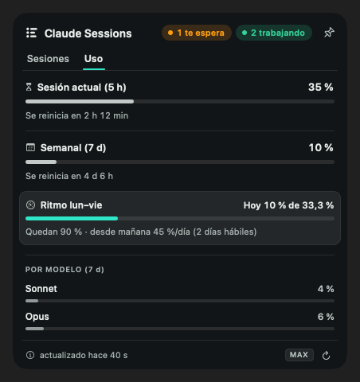

# Claude Sessions

**Todas tus sesiones de Claude Code en la barra de menú, y a un click de la ventana donde viven.**

[English](README.md) · MIT · macOS 13+ · Apple Silicon e Intel


Con varias sesiones de Claude Code abiertas terminas buscando pestañas: ¿cuál espera un permiso, cuál terminó, cuál sigue trabajando? Claude Sessions vive en la barra de menú y te lo dice en tiempo real.

> Proyecto no oficial. Sin afiliación, respaldo ni patrocinio de Anthropic. "Claude" y "Claude Code" son marcas de Anthropic.

## Qué hace

- **Tres estados por sesión**: *te espera* (naranjo), *trabajando* (verde) y *terminó* (gris). Muestra por qué te espera (pregunta, plan por aprobar, permiso para una herramienta), el último prompt y hace cuánto pasó.
- **Click en una sesión → su ventana de VS Code pasa al frente y se abre la pestaña de esa sesión.** La app confirma que la ventana correcta quedó al frente antes de abrir la pestaña, así que no cae en otra.
- **Un aviso flotante cuando una sesión te necesita**, en silencio si ya estás mirando esa ventana.
- **Comandos retenidos por un guardián** (un chequeo previo que pausa un comando riesgoso hasta que lo confirmes) aparecen como *te espera*, aunque Claude Code no dispare ningún evento.
- **Subagentes**, modelo, tokens y duración de cada sesión.
- **Pestaña Uso** (Pro/Max): límites de 5 horas y semanal, desglose por modelo, uso extra y un *ritmo lun–vie* que reparte lo que te queda del límite semanal entre los días hábiles que faltan.
- Inglés y español.

| Uso | English |
|---|---|
|  |  |

## Compatibilidad

| | Soporte |
|---|---|
| Mac | Apple Silicon e Intel (binario universal), macOS 13 Ventura o posterior |
| Claude Code en **VS Code** (extensión) | ✔ estados, click a la ventana, click a la pestaña |
| Claude Code en una **terminal** | ✔ estados · el click todavía no enfoca la terminal (solo trae VS Code al frente) |
| Cursor y otros forks de VS Code | Todavía no, está planificado |
| App de escritorio de Claude (chat) | No: no corre sesiones de Claude Code con hooks |
| Python | 3.9+ para el hook de estado (Homebrew, python.org, pyenv/asdf/uv/conda o el de Xcode) |

## Instalación

**1. La app**

1. Descarga `Claude-Sessions-<versión>.zip` desde [Releases](../../releases) y descomprímelo.
2. Mueve **Claude Sessions.app** a **/Applications** *antes* de abrirla.
3. La app no está notarizada, así que macOS bloquea el primer arranque. Ábrela una vez, ve a **Configuración del Sistema → Privacidad y seguridad** y haz click en **Abrir igualmente** (macOS 15+; en macOS 13–14 también sirve click derecho → Abrir).
4. Da permiso de **Accesibilidad** cuando lo pida (Configuración del Sistema → Privacidad y seguridad → Accesibilidad). Se usa solo para ver qué ventana está al frente, para que el click caiga en la correcta. Sin él la app funciona igual y espera un tiempo fijo.

**2. El hook de estado** (un plugin de Claude Code; en cualquier sesión de Claude Code):

```text
/plugin marketplace add tactician200/CC-sessions
/plugin install claude-sessions-state@cc-sessions
```

El hook escribe un archivo JSON pequeño por sesión en `~/.claude/sessions-state/`. Sin él, la app adivina el estado por la hora de los transcripts (menos preciso y sin el estado *te espera*).

> **¿Usas `claude-sessions-tracker`** (el plugin original de upstream)? Desinstálalo primero: los dos escriben los mismos archivos. La app te avisa si lo detecta.

**Compilar desde el código**: `./build-app.sh` (necesita Xcode Command Line Tools y Swift 5.9+) y copia `build/Claude Sessions.app` a /Applications.

## Verifica la descarga

La app lee tu token OAuth de Claude desde el Llavero (ver Privacidad), así que comprueba que el zip es el que GitHub Actions compiló desde este repositorio:

```bash
shasum -a 256 Claude-Sessions-<versión>.zip      # compáralo con el SHA256 de las notas del release
gh attestation verify Claude-Sessions-<versión>.zip --repo tactician200/CC-sessions
```

## Privacidad

- **Nada sale de tu Mac**, salvo una petición: la pestaña Uso lee tu token OAuth de Claude Code desde el Llavero y lo envía **solo** a `api.anthropic.com` para traer el uso de tu plan. Sin telemetría, sin analítica, sin otras llamadas de red.
- Lee, en local: los transcripts de Claude Code en `~/.claude/projects/`, los archivos del hook en `~/.claude/sessions-state/` y la lista de ventanas de tu editor.
- Cada actualización es un binario nuevo sin firma, así que macOS vuelve a pedir acceso al Llavero. Es esperable: verifica la descarga antes de permitirlo.
- El endpoint de uso no está documentado públicamente y puede cambiar o dejar de funcionar; el resto de la app no depende de él.

## Desinstalar

1. Sal desde el menú del engranaje en el panel y borra `/Applications/Claude Sessions.app`.
2. En Claude Code: `/plugin uninstall claude-sessions-state@cc-sessions`.
3. Opcional: `rm -rf ~/.claude/sessions-state`.

## Cómo funciona

```
Claude Code ──eventos de hook──▶ plugin (Python) ──▶ ~/.claude/sessions-state/<id>.json
                                                              │
~/.claude/projects/*.jsonl (modelo, tokens, subagentes) ──────┤
                                                              ▼
                                             Claude Sessions (Swift, barra de menú)
                                                              │ click
                                                              ▼
                          `code <carpeta>` → ventana confirmada al frente → abre la pestaña de la sesión
```

Tests: `bash tests/run-all.sh` (self-tests de Swift + la suite pytest del hook).

## Créditos

Fork de [hassekf/claude-sessions-menubar](https://github.com/hassekf/claude-sessions-menubar) de Charles Hasse (MIT, commit base `08ae051`), que creó la app de barra de menú, la pestaña de uso y el plugin original.

## Licencia

[MIT](LICENSE)
