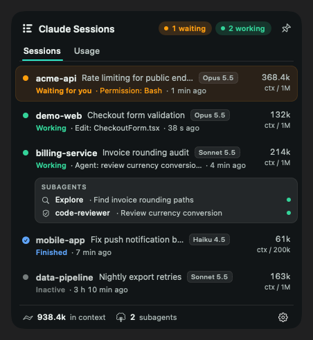
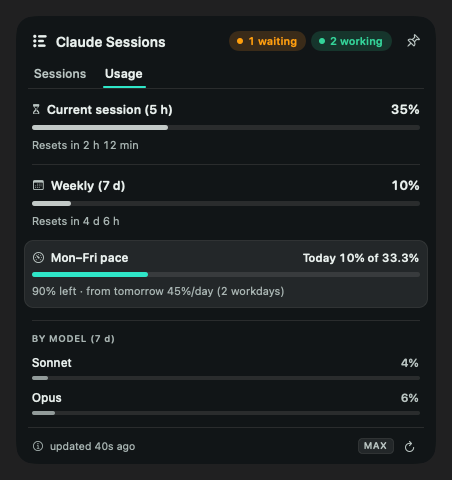
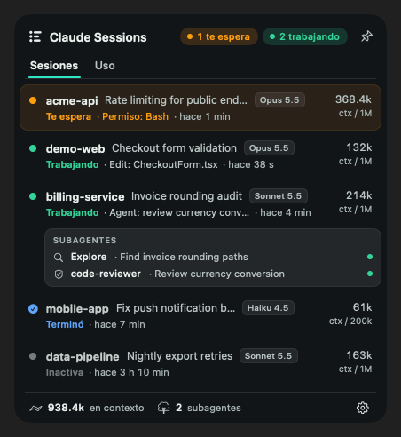

# Claude Sessions

**Every Claude Code session on your Mac, one glance away — and one click from the window it lives in.**

[Español](README.es.md) · MIT · macOS 13+ · Apple Silicon & Intel



Running several Claude Code sessions at once means tab-hunting: which one is waiting for a permission, which one finished, which one is still working? Claude Sessions sits in the menu bar and answers that in real time.

> Unofficial project. Not affiliated with, endorsed by or sponsored by Anthropic. "Claude" and "Claude Code" are trademarks of Anthropic.

## What it does

- **Three states per session** — *waiting for you* (orange), *working* (green), *done* (grey) — with the reason it is waiting (question, plan to approve, permission for a tool), the last prompt and how long ago it happened.
- **Click a session → its VS Code window comes to the front and the session's tab opens.** The app confirms the right window is in front before opening the tab, so it never lands in the wrong one.
- **A floating notice when a session needs you**, silent when you are already looking at that window.
- **Commands held by a guard** (a pre-tool check that pauses a risky command for confirmation) show up as *waiting*, even though Claude Code fires no event for them.
- **Subagents**, model, tokens and duration for each session.
- **Usage tab** (Pro/Max): 5-hour and weekly limits, per-model breakdown, extra usage, and a *workday pace* that spreads your remaining weekly limit over the remaining Monday–Friday days.
- English and Spanish.

| Usage | Español |
|---|---|
|  |  |

## Compatibility

| | Supported |
|---|---|
| Mac | Apple Silicon and Intel (universal binary), macOS 13 Ventura or newer |
| Claude Code in **VS Code** (extension) | ✔ states, click-to-window, click-to-tab |
| Claude Code in a **terminal** | ✔ states · click-to-terminal not yet (a click just brings VS Code forward) |
| Cursor and other VS Code forks | Not yet — planned |
| Claude desktop app (chat) | No — it does not run Claude Code sessions with hooks |
| Python | 3.9+ for the state hook (Homebrew, python.org, pyenv/asdf/uv/conda or Xcode's) |

## Install

**1. The app**

1. Download `Claude-Sessions-<version>.zip` from [Releases](../../releases) and unzip it.
2. Move **Claude Sessions.app** to **/Applications** *before* opening it.
3. The app is not notarized, so macOS blocks the first launch. Open it once, then go to **System Settings → Privacy & Security** and click **Open Anyway** (macOS 15+; on macOS 13–14 you can also right-click → Open).
4. Grant **Accessibility** when asked (System Settings → Privacy & Security → Accessibility). It is used only to check which window is in front, so a click lands on the right one. Without it the app still works and waits a fixed delay instead.

**2. The state hook** (a Claude Code plugin — in any Claude Code session):

```text
/plugin marketplace add tactician200/CC-sessions
/plugin install claude-sessions-state@cc-sessions
```

The hook writes one small JSON file per session to `~/.claude/sessions-state/`. Without it the app falls back to guessing from transcript timestamps (less precise, no *waiting* state).

> **Already using `claude-sessions-tracker`** (the original upstream plugin)? Uninstall it first — both write the same files. The app shows a warning if it detects it.

**Build from source** instead: `./build-app.sh` (needs Xcode Command Line Tools, Swift 5.9+), then copy `build/Claude Sessions.app` to /Applications.

## Verify the download

The app reads your Claude OAuth token from the Keychain (see Privacy), so check that the zip is the one GitHub Actions built from this repository:

```bash
shasum -a 256 Claude-Sessions-<version>.zip      # compare with the SHA256 in the release notes
gh attestation verify Claude-Sessions-<version>.zip --repo tactician200/CC-sessions
```

## Privacy

- **Nothing leaves your Mac**, except one request: the Usage tab reads your Claude Code OAuth token from the Keychain and sends it **only** to `api.anthropic.com` to fetch your plan's usage. No telemetry, no analytics, no other network calls.
- It reads, locally: Claude Code transcripts in `~/.claude/projects/`, the hook's files in `~/.claude/sessions-state/`, and your editor's window list.
- Each update is a new unsigned binary, so macOS asks again for Keychain access. That prompt is expected — verify the download before you allow it.
- The usage endpoint is not publicly documented and may change or stop working; the rest of the app does not depend on it.

## Uninstall

1. Quit from the gear menu in the panel and delete `/Applications/Claude Sessions.app`.
2. In Claude Code: `/plugin uninstall claude-sessions-state@cc-sessions`.
3. Optionally `rm -rf ~/.claude/sessions-state`.

## How it works

```
Claude Code ──hook events──▶ plugin (Python) ──▶ ~/.claude/sessions-state/<id>.json
                                                           │
~/.claude/projects/*.jsonl (model, tokens, subagents) ─────┤
                                                           ▼
                                          Claude Sessions (Swift, menu bar)
                                                           │ click
                                                           ▼
                              `code <folder>` → window confirmed in front → open the session tab
```

Run the tests with `bash tests/run-all.sh` (Swift self-tests + the hook's pytest suite).

## Credits

Forked from [hassekf/claude-sessions-menubar](https://github.com/hassekf/claude-sessions-menubar) by Charles Hasse (MIT, base commit `08ae051`), which created the menu bar app, the usage tab and the original tracker plugin.

## License

[MIT](LICENSE)
